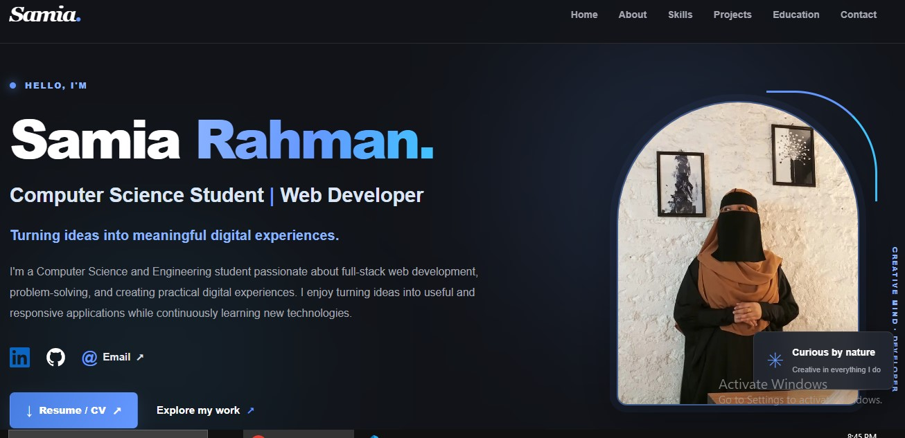

# Samia Rahman — Personal Portfolio

Welcome to my personal portfolio! 👋

I'm a Computer Science and Engineering student passionate about web development, problem-solving, and building user-friendly web applications.

This portfolio showcases my projects, technical skills, learning journey, and experience in frontend and full-stack development.

## 🌐 Live Website

[Visit My Portfolio](https://my-portfolio-virid-nu-81.vercel.app/)

## 📸 Portfolio Preview

## 👩‍💻 About Me

- 🎓 Computer Science and Engineering student
- 💻 Interested in Full Stack Web Development
- 🌱 Currently learning Next.js, TypeScript, and modern web technologies
- 🚀 Enjoy building practical web applications
- 📍 Bangladesh

## 🛠️ Technologies & Skills

### Languages
- JavaScript
- TypeScript
- HTML5
- CSS3
- PHP

### Frontend
- React
- Next.js
- Tailwind CSS
- Responsive Web Design

### Backend & Database
- Node.js
- Express.js
- PHP
- MySQL

### Tools
- Git
- GitHub
- VS Code
- Vercel

## 🚀 Featured Projects

### 1. UniBus
A university bus booking platform that allows students to book seats in advance and travel comfortably.

**Technologies:** HTML, CSS, JavaScript, PHP, MySQL

🔗 [Live Project](https://unibus-sec.infinityfreeapp.com/)

### 2. FitLog
A responsive workout library and fitness planner where users can explore exercises, view workout details, save workouts, and organize daily plans.

**Technologies:** Next.js, TypeScript, React, Tailwind CSS

🔗 [Live Project](https://fitlog-coral-nu.vercel.app/)
🔗 [GitHub Repository](https://github.com/tosamia/B14-A6-Fit-Log)

### 3. Smart Retain Manager
A collaborative web application where I contributed to backend development and server-side functionality.

**Technologies:** JavaScript, Node.js, Express.js, MySQL

🔗 [GitHub Repository](https://github.com/monima40/smart-retain-manager)

### 4. BazarDor
A Bangladesh-focused market price application designed to help users explore product prices and market information.

**Technologies:** Next.js, TypeScript, Tailwind CSS, API

### 5. Doctor Appointment
A web application designed to help patients book doctor appointments and reduce waiting time.

**Technologies:** HTML, CSS, JavaScript, PHP, MySQL

## 📫 Connect With Me

- **GitHub:** [tosamia](https://github.com/tosamia)
- **LinkedIn:** [Samia Rahman](https://www.linkedin.com/in/samia-rahmann/)
- **Email:** [samiasamian2003@gmail.com](mailto:samiasamian2003@gmail.com)

---

⭐ Thank you for visiting my portfolio repository!